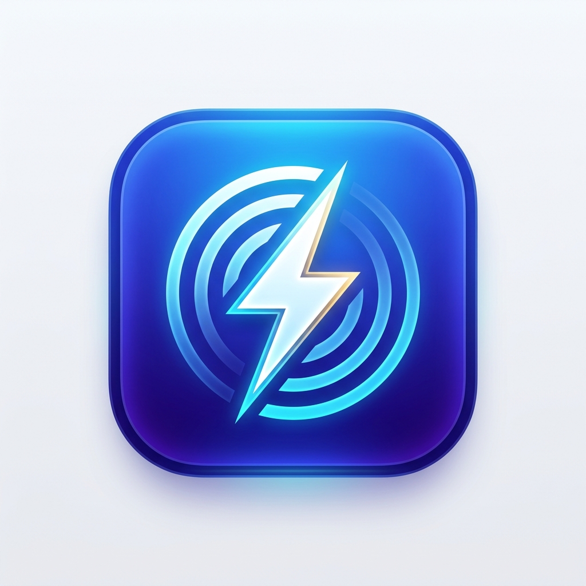

<div align="center">



# QuickMessage (极简快传)

**A lightweight, zero-configuration, cross-platform LAN transfer tool with built-in privacy protection and burn-after-read.**  
**一款极简、免安装、单文件、跨平台的局域网快传利器，专注隐私保护与阅后即焚。**

[](https://github.com)
[](./LICENSE)
[-orange.svg?style=flat-square)](https://github.com)
[](https://github.com)
[](https://github.com)

[简体中文](#简体中文) | [English](#english)

</div>

---

<a name="简体中文"></a>
## 🇨🇳 简体中文

### 💡 为什么需要 QuickMessage？
在没有微信文件传输助手、不愿登录聊天账号、或在不同操作系统（如 macOS 与 Windows PC、手机与电脑）之间传输小文件或文本时，现有的工具往往过于臃肿，甚至存在云端泄露与历史记录留存的风险。

**QuickMessage** 仅用单个不到 **400KB** 的轻量级独立 C 语言二进制程序，内嵌了现代化极简 Web 控制台，手机打开相机扫一扫二维码即可瞬间连入传输。

### ✨ 核心特性

- 🔒 **极致隐私与阅后即焚 (Burn-After-Read)**：
  - **纯内存流转**：文本与传输数据仅驻留于系统 RAM，无数据库，不生成持久化历史记录。
  - **下载即焚**：接收方点选下载私密文件后，服务端**立即物理抹除并删除**本地磁盘文件。
  - **一键自焚**：随时可在网页端点击 `🔥 立即焚毁`，两端及服务器彻底抹除对应条目。
  - **身份抹除**：浏览器标签页一旦关闭，会话临时身份即刻销毁。程序退出时自动全盘擦除临时目录。
- 🎯 **多人在线与定向私密传输**：
  - 自动发现局域网内的在线设备（自动识别 iPhone、Android、MacBook、Windows PC）。
  - 支持**全员广播**或**一对一定向私传**，非目标设备完全不可见。
- 📋 **电脑剪贴板双向互通**：
  - 手机发送给电脑的内容，电脑端**自动写入系统剪贴板**，省去反复粘贴步骤。
  - 手机端可一键“📋 获取电脑剪贴板”，实现手机端秒取电脑文本。
- 📱 **多网卡智能探测与矢量二维码**：
  - 自动识别并推荐最优 Wi-Fi 局域网 IP，支持虚拟网卡与回环接口自由切换。
  - 纯 C 原生计算并输出高质量矢量 SVG 二维码，手机相机直接秒扫直连。
- 🌐 **原生中英双语 (i18n)**：
  - 控制台与网页端均支持中英双语无缝切换，自动跟随系统语言。
- 🪶 **超强兼容与极致轻巧**：
  - **单文件分发**：无需安装 Python、Node.js 或任何运行库，直接双击运行。
  - **跨平台**：macOS 版原生支持 Apple Silicon (M1/M2/M3/M4) 与 Intel x86_64；Windows 版静态编译，向上兼容 Win11，向下直穿 **Windows XP**。

---

### 🚀 快速上手

#### 方式一：直接运行预编译版本 (推荐)
从 [Releases](../../releases) 页面下载对应系统的压缩包：
- **macOS**：解压运行 `QuickMessage.app` 或在终端运行 `./quickMessage_mac`。
- **Windows**：双击运行 `quickMessage_win.exe`。

控制台将自动显示访问地址并拉起默认浏览器，手机连接同一局域网 Wi-Fi 后扫描屏幕上的二维码即可进入控制台。

#### 命令行启动选项
```bash
# 默认端口启动 (默认 8080，冲突时自动顺延)
./quickMessage_mac

# 指定端口启动
./quickMessage_mac 8888

# 强制使用英文启动
./quickMessage_mac --lang en

# 强制使用中文启动并在 9000 端口运行
./quickMessage_mac 9000 --lang zh
```

---

<a name="english"></a>
## 🇬🇧 English

### 💡 Why QuickMessage?
Transferring snippets or files across devices (e.g. from an iPhone to a Windows PC or MacBook) usually requires logging into heavy chat apps or uploading to third-party cloud servers. 

**QuickMessage** is built entirely in lightweight pure C, packaged into a single standalone binary under **400 KB**. It embeds a clean Apple-style web interface with zero setup. Scan a QR code with your smartphone camera and start transferring instantly.

### ✨ Highlights

- 🔒 **Ultimate Privacy & Burn-After-Read**:
  - **In-Memory Only**: Messages stay purely in RAM. Zero database, zero persistent history.
  - **Burn on Download**: Targeted private files are physically destroyed from the disk the exact moment the recipient finishes downloading.
  - **Instant Burn**: Click `🔥 Burn Now` to wipe any item permanently from all ends.
  - **Zero Trace on Exit**: Closing browser tabs wipes client identity; closing the app thoroughly erases all temporary files.
- 🎯 **Multi-device Awareness & Direct Messaging**:
  - Live discovery of connected devices on the LAN (auto-detects iPhone, Android, PC, Mac).
  - Flexible targeting: Broadcast to everyone or send privately to a single device (hidden from others).
- 📋 **Seamless PC Clipboard Sync**:
  - Direct messages sent to the PC host are automatically copied to the system clipboard.
  - Mobile devices can fetch PC clipboard content with one tap.
- 📱 **Smart Multi-NIC Detection & Vector QR**:
  - Automatically identifies local IP addresses, ranks active Wi-Fi interfaces, and generates crisp SVG QR codes on the fly.
- 🌐 **Native Bilingual Support (English / Simplified Chinese)**:
  - Both terminal logs and Web UI toggle effortlessly between English and Chinese.
- 🪶 **Ultra-portable Single Binary**:
  - No Python, Node.js, or runtime libraries required.
  - **macOS**: Universal Binary (Apple Silicon + Intel).
  - **Windows**: Statically linked PE32 binary compatible from **Windows XP up to Windows 11/12**.

---

### 🛠️ 源码编译 (Build from Source)

本项目依赖纯标准 C 库与 POSIX/Win32 套接字，无需任何外部第三方依赖。

#### macOS 构建
需要安装 Xcode Command Line Tools：
```bash
make mac
# 输出通用二进制: quickMessage_mac (arm64 + x86_64)
```

#### Windows 构建 (在 macOS / Linux 上交叉编译)
需要安装 MinGW-w64：
```bash
brew install mingw-w64   # macOS
# sudo apt install mingw-w64  # Ubuntu/Debian

make win
# 输出 Windows 静态可执行程序: quickMessage_win.exe
```

#### 同时构建全平台版本并清理
```bash
make clean && make all
```

---

### 📂 项目结构 (Project Structure)

```text
quickMessage/
├── main.c              # 核心 C 语言 HTTP/Socket 高性能事件服务与控制台
├── web_ui.h            # 内嵌响应式 Web 前端 (HTML5 / Modern CSS / Vanilla JS)
├── qrcodegen.c         # 高性能 C 语言二维码生成核心算法
├── qrcodegen.h         # 二维码头文件
├── icon.ico            # Windows 多分辨率内嵌图标 (16~256px 完整层级)
├── AppIcon.icns        # macOS 高清程序图标包
├── app.rc              # Windows 资源定义 (图标与版本元数据)
├── Makefile            # 跨平台自动化编译脚本
├── LICENSE             # MIT 开源许可证
└── README.md           # 详细文档说明
```

---

### 👨‍💻 作者 (Author)

Designed & Developed with ❤️ by **Kinson Wu**

### 📄 许可证 (License)

本项目采用 [MIT License](./LICENSE) 协议开源，欢迎自由使用、修改与分享。
